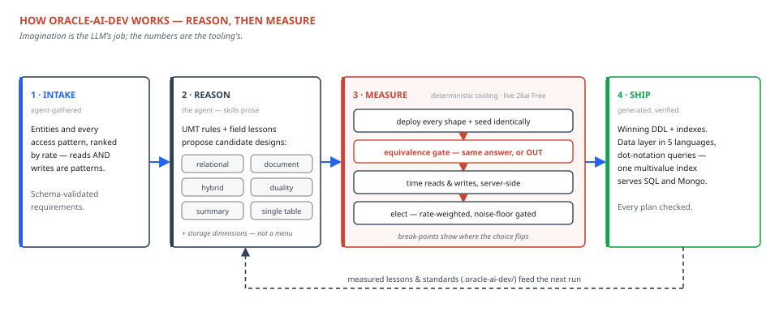

# oracle-ai-dev

Guided, zero-to-app development on **Oracle AI Database 26ai Free**, for Claude
Code and OpenAI Codex. It stands up the database, models your data on Oracle's
converged engine using Unified Model Theory, and — its centerpiece — **measures**
which physical shape actually serves your access patterns best, then generates a
working data-access layer for it. The bundled Oracle SQLcl MCP server gives the
agent live database access throughout.



Install on either platform → see [INSTALL.md](./INSTALL.md).
End-to-end tour → see [docs/WALKTHROUGH.md](./docs/WALKTHROUGH.md).
How it fits together → see [docs/ARCHITECTURE.md](./docs/ARCHITECTURE.md).
Every validation & generation rule, per shape → see [docs/model-rules-reference.md](./docs/model-rules-reference.md).
Tuning the engines & custom standards → see [docs/tuning-and-custom-standards.md](./docs/tuning-and-custom-standards.md).

---

## Why this exists

Oracle's one engine can store the same data as normalized relational, a JSON
collection, a JSON Relational Duality view, a graph, or vectors. **Choosing the
shape is the highest-leverage decision in the design** — and the right choice
depends on your access patterns and your read/write balance, not on dogma. This
plugin makes that choice *measured* rather than guessed: it generates the query
for each candidate shape, benchmarks them against representative data with
deterministic server-side metrics, models write amplification, and ranks the
options with the frequency break-points where the winner changes.

## A turnkey AI-data & AI-agent stack

It's also the fastest way to stand up Oracle AI Database 26ai for AI development.
One flow brings up the converged engine in Docker and enables exactly the surfaces
you need — no manual DBA work. The setup path (`oracle-ai-setup`) does this for you,
sizes it to Free's limits, and tells you up front what won't work on Free (e.g.
vector/text search through the Mongo API) and routes you to what does.

**Supported configurations.** Two compose profiles you can bring up as-is:
- **`db`** — the database itself (SQL*Net on 1521): relational, JSON, duality, graph,
  and vectors on one engine.
- **`db-ords`** — adds ORDS: the **MongoDB-compatible API** (27017), plus **REST** and
  **GraphQL** (8080). Both profiles self-check via `ASSERT:<name>:PASS`.

**Enable features à la carte** with idempotent, self-verifying configurators
(`assets/tooling/configure/`), each printing its own `ASSERT`: the app user,
**AI Vector Search** memory (HNSW; IVF is zero-config), the **Mongo API**, **SODA**,
**JSON Relational Duality + GraphQL**, **SQL/PGQ property graph**, **Select AI**
(natural-language-to-SQL over your chosen LLM), **Oracle Text**, and an **offline ONNX
embedding model** — `setup-embedding-model.sh` auto-downloads Oracle's prebuilt
all-MiniLM-L12-v2, stages it, grants the privileges, loads it, and verifies
`VECTOR_EMBEDDING()` in one command, for air-gapped RAG and server-side embedding.

What you get is two turnkey stacks on one engine:
- **A turnkey AI-data platform** — AI Vector Search, semantic/hybrid retrieval, RAG
  (offline-first embeddings), and Select AI, with your operational data alongside.
- **A turnkey AI-agent development stack** — Oracle as the agent's memory, state,
  knowledge, and toolset, reachable over the bundled **SQLcl MCP server** for live,
  governed database access. Compatible with the **Oracle agent-memory labs**: durable
  memories as vector-embedded rows behind an updatable JSON duality view
  (`superseded_by` revision, COSINE recall), and the `oracleagentmemory` / LangGraph
  (`AsyncOracleSaver`, `OracleSemanticCache`) stack drops straight on — see
  [ai-agent-dev](skills/ai-agent-dev/references/agent-memory.md).

## Quickstart

**Just tell your coding agent** *"I want to build X on Oracle AI Database"* — or
*"migrate my existing app to Oracle"* (it reverse-engineers a model from your current
DDL, documents, `$jsonSchema`, Mongoose, or DynamoDB export, then reviews it). The
**oracle-ai-dev** router runs the intake, recommends the paths and features, and
**executes the scripts for you** through the skills — you approve; you don't
copy-paste shell. Each configurator emits `ASSERT:<name>:PASS` so the agent confirms
each step. Under the hood, that's:

```bash
# 1. Stand up the Free stack (DB only, or db-ords for the Mongo API / REST / GraphQL)
docker compose -f assets/compose/db.compose.yml up -d

# 2. Create an app user and enable the features the advisor recommended (idempotent, self-verifying)
assets/tooling/configure/create-plugin-user.sh <sysdba-conn>
assets/tooling/configure/enable-vector-memory.sh <sysdba-conn>   # only if you want HNSW
assets/tooling/configure/setup-embedding-model.sh <container> <pdb> <user> <password>  # in-DB embeddings (RAG / agent memory)
```

The agent runs these on your behalf, then walks you through the paths below. On its
first use in a project it also runs a **one-time gap-fill**: it reconciles its shipped
[operating principles](./skills/oracle-data-modeling/references/operating-principles.md)
against your own `CLAUDE.md`/`AGENTS.md`, stays *silent* on every principle you already
cover, asks once about the real gaps, and records each adopt/decline in
`.oracle-ai-dev/standards.md` so it never asks again. That store is the project's own
knowledge, in plain committable files: `standards.md` (org directives **and** adopted
operating principles — it governs) and `lessons.md` (what this project has measured — it
informs), both read before every modeling session. Your standards outrank the shipped
defaults, with exactly three carve-outs that are never overridable: the
destructive-operation override, nothing-identifying-ships, and the claims guardrails.
The [superpowers companion skills](./INSTALL.md#companion-plugins) are soft dependencies
with inline fallbacks — nothing degrades without them. Full contract:
[local-knowledge.md](./skills/oracle-data-modeling/references/local-knowledge.md).

## How to use — the menu

There is no help command to memorize: **the menu below IS the interface.** Every skill
carries a trigger-rich description, so on both Claude Code and Codex you invoke it by
*describing the goal* — "help me migrate our DynamoDB tables to Oracle" loads the
**oracle-ai-dev** router, which interviews you (never more than three questions per turn)
and hands off to the right path. Three ways to drive it, in the order people actually
should:

1. **Just describe the goal.** That's the design. Natural prompts like the examples in
   the right-hand column route to the right skill in a clean session — no invocation
   syntax, and it works identically in both CLIs.
2. **Name the skill explicitly** when you already know where you're going: in Claude
   Code, "use the oracle-data-modeling skill on this schema"; in Codex, `/skills` lists
   them or `$oracle-data-modeling` invokes one directly.
3. **Start from the demo flow:** "set up Oracle and model my e-commerce data" exercises
   the whole sequence — setup → intake → recommendation → live measured proof.

| Skill | Say something like… |
|---|---|
| **oracle-ai-dev** (router) | "I want to build an app on Oracle" / "migrate my MongoDB app to Oracle" — routes you to the right path below, runs the intake questionnaire, or critiques requirements you already have |
| **oracle-ai-setup** | "Stand up Oracle 26ai Free in Docker" / "my Oracle container won't start" — compose profiles, feature configurators, `doctor`, verify harness |
| **sqlcl-mcp-setup** | "Connect Claude/my agent to my Oracle database" — wires the SQLcl MCP server with the right security posture |
| **oracle-data-modeling** | "Model my data" / "review this schema" — the UMT flagship: access-pattern intake → shape recommendation per entity, with the measured optimization loop, a mechanical duality design-gate rulebook, and field-hardened lessons from real engagements |
| **sql-json-dev** | "Store JSON in Oracle" / anything `JSON_TABLE`, `JSON_TRANSFORM`, JSON indexing |
| **json-duality-dev** | "Same data as tables *and* documents" — duality view design and CRUD via SQL, GraphQL, or Mongo API |
| **mongodb-api-dev** | "Run mongosh/my Mongo driver against Oracle" — compatibility matrix + the three-lane migration framework |
| **soda-dev** | Document CRUD from *inside* the database (PL/SQL, MLE JS, SQLcl) or bridging one collection across APIs |
| **adb-dynamodb-api** | "Run my DynamoDB app/AWS SDK against Oracle" — enabling the DynamoDB-compatible API on ADB, key minting, and the undocumented client settings |
| **ords-rest-sql-headless-adb** | Drive a wallet-less Autonomous Database from scripts/CI by POSTing SQL to ORDS REST-Enabled SQL |
| **vector-rag-dev** | "Add vector search / RAG" — offline-first, in-database ONNX embeddings on the Free container |
| **ai-agent-dev** | "Build an agent with Oracle as memory/knowledge/tools" — client-side frameworks or in-DB Select AI |
| **query-craft** | "Write/translate this query" — SQL, SQL/JSON paths, `GRAPH_TABLE`, Mongo pipeline→SQL; everything plan-checked |
| **query-tuning** | "This query is slow" — measure-driven loop with EXPLAIN/AWR/advisors (all licensed on Free) |

Two menu-adjacent notes: the router's
[multi-level help](./skills/oracle-ai-dev/references/help.md) holds the full routing
decision table if you want to see the logic itself, and each skill ends with a verify
step (`assets/verify/`) — "prove it works" is part of every path, not an afterthought.

> ### 📋 Worked example: [Hospital Admissions](./examples/hospital-admissions/EXAMPLE.md)
> A real end-to-end session — a product spec and a DBA's normalized schema in, an
> optimized Oracle 26ai data layer out. The plugin derived the access patterns, ran
> the competing candidate designs on a live Free instance, **measured** them (relational and
> document came out tied at 0.2% — it refused to fake a winner and reported *when the
> tie breaks* instead), benchmarked native SQL vs the MongoDB API, and shipped a Java
> data layer with `mvn verify` green at 13/13. The [full output and session log](./examples/hospital-admissions/)
> are in the repo — including the 20× "create the index through the surface that
> queries it" lesson.

## The measured optimization engine

The flagship. **One command runs the whole loop against your live database:**

```bash
python -m tooling.optimize <workload.json> --fresh --out ./out
# ~65s: deploy every candidate design -> seed -> VALIDATE ANSWERS -> measure every
#       pattern x design cell -> analyse every plan -> decide -> emit the winning DDL
```

### The walk — the six stations are not a menu

```
document -> single collection -> hybrid -> duality -> summary -> relational
```

These are the **stations a design moves through as write pressure climbs**, and all six
compete by default. `hybrid` is a relational core carrying its variable attributes in one
JSON flex column on its own `_h` lane — less consolidated than a single collection, more
than pure relational; that column is emitted as `JSON (OBJECT LIMIT 8192)`, an *enforced*
inline guarantee rather than a hope, so the OSON inline-to-LOB decay cliff cannot happen by
construction. `summary` is a relational core on its own `_s` lane plus declared
`REFRESH FAST ON COMMIT` aggregate materialized views; their maintenance is **measured** and
charged to the write cells, disclosed as a `SUMMARY MAINTENANCE` breakdown rather than
quietly amortized. Neither has to be hand-declared — the optimizer auto-nominates both by
heuristic when your model doesn't. With `sql_view` that is **seven designs** generated in
all: `sql_view` is deliberately *not* a station — it is a read-only JSON projection over
relational storage, so listing it beside `relational` is redundant. It survives as duality's
fallback for the one thing duality cannot express: an aggregation, because the view must
stay updatable.

**Four dimensions compose with all of it.** Shape is not the only physical choice, so four
per-entity **storage dimensions** ride along with the base-table designs and are measured in
the same election: `partition` (`interval` / `auto_list` / `hash` — which makes retention a
metadata-only drop instead of a `DELETE`'s redo and undo; `--no-partition`),
`organization: "index"` (an IOT, always emitted with an `OVERFLOW` segment; `--no-iot`),
`compress: "advanced"` (Advanced Row Compression, included on Free; `--no-compress`), and the
hybrid flex limit (`--flex-limit` / `--no-flex-limit`). Every clause is probe-grounded and
live-verified on 26ai Free, and each `--no-` flag measures the *same* design without the
dimension — the counterfactual is one flag away. The mechanism under each, and the
engine-enforced conflicts that are refused by name (an IOT with compression, an IOT with a
non-hash partition family), are in
[storage-mechanics.md](./skills/oracle-data-modeling/references/storage-mechanics.md).

Two of them are **derived, not guessed**:

- **The single collection.** Tell it the entity properties a result set needs and the filters
  a query applies, and the keys fall out: the *filters* pick the anchor (the query root
  carrying the most traffic); the *result set* decides what co-locates (an entity returned
  alongside the anchor, and dependent on it, keys **anchor-first** — `(anchor_col, own_pk)`,
  exactly a DynamoDB PK+SK, so one indexed read returns the item collection — including the
  far side of an M:N, behind a junction table); shared parents and reference data stay on
  their own key rather than being duplicated into every item collection; the non-anchor
  filters become the GSI-equivalent indexes.
- **The duality views.** One view **per aggregate**, not one per root — a view costs exactly
  what it nests, and its attributes are scoped at every level (root, nested parent, junction,
  and the far side of the M:N). Every read *and write* goes through the leanest view that can
  serve it.

### Six things it does that a hand-rolled benchmark forgets

1. **Equivalence before speed.** Before a single timing, **every design must return the same
   answer** for every pattern, or its cells are not measured at all. *A design that returns
   less is faster, and a stopwatch cannot tell the difference.* Three of the seventeen defects
   we found in this harness were exactly that.
2. **The access path for every cell.** It pulls the **execution plan** for each
   (pattern × design) and prints how the design actually served the pattern — `IDX UNIQUE`,
   `IDX RANGE`, `IDX FFS`, `FULL SCAN` — with logical reads. A filtered read that full-scans
   is reported as a **warning**, not a datapoint. *A number without its access path is not
   evidence.*
3. **It refuses to oversell.** Live timings carry a few percent of noise, so a margin inside
   the noise floor prints **`TOO CLOSE TO CALL`** and names the tie rather than asserting a
   winner. On a converged engine the relational-storage designs frequently *are* tied — same
   rows, same indexes, different access paths.
4. **It says what decided it — and where that verdict travels.** Every election prints
   `decided by: point reads …` or `decided by: scan economics …`, generated from the measured
   plans. The split is research-verified: Exadata smart scan and storage indexes cheapen only
   direct-path full-segment scans, and buffer-cache point reads never offload — so a
   point-read-decided margin **carries to Exadata-class deployments**, while a scan-decided
   one is *environment-conditional* and must be re-validated on the target.
5. **It admits when the fixture was too small.** A pattern that declares `expect_rows` whose
   deciding cell answered fewer rows is flagged **`!! PROVISIONAL`** — production cardinality
   unproven. A winner elected on a degenerate seed was elected on incidental costs; re-seed at
   representative volume before trusting it.
6. **It charges maintenance where maintenance happens.** Whenever `summary` competes,
   **`SUMMARY MAINTENANCE`** prints the per-write-pattern summary-vs-relational delta — what
   the materialized views' upkeep actually costs at that pattern's rate. Summary's write cells
   time `execute + COMMIT`, so incremental view maintenance sits *inside* them, while every
   other design's writes roll back and pay no commit at all. The bias runs **against** summary,
   and it is disclosed rather than silently corrected.

### The knob is the mix — and re-weighting is free

A cell is a property of the schema and the data, **not of how often the pattern runs** — so a
named workload is a *re-weighting of measurements already taken*. One measurement pass, many
workloads:

```
  scenario                        read:write   document    duality  relational  winner      margin
  reservation system (real mix)         61:1  3,856,298  4,153,010   4,141,200  document      7.4%
  mobile / check-in                     38:1  2,420,130  2,843,639   2,595,896  document      7.3%
  full-service airline (+dashboard)     35:1  5,991,703  6,483,152   6,588,182  document      8.2%
  analytics / KPIs                 read-only 11,381,778 12,473,967  12,598,852  document      1.4%
  booking engine (write-heavy)           1:3  6,965,861  7,211,706   6,590,082  relational    5.0%
```
*(Production-volume run, 2026-07-14: 300k reservations / 1.2M leg rows, 30 trials — the
headline margins sit inside this host's measured noise floor, so the engine prints
`TOO CLOSE TO CALL` and names the tie; the write-heavy row is the most stable separation.
Full report: `tests/integration/airline/optimizer-result.txt`.)*

**Once every design is fairly indexed, the reads converge — and the only thing that separates
them is WRITE PRESSURE.** That is the consolidation walk, arrived at by measurement rather
than assertion, and it is the one cost in the table that a better index cannot make go away.

> **Reads *and* writes are first-class rows.** The matrix is built in **one consistent unit**
> (median elapsed µs), deliberately: logical reads and redo bytes are *different units* and a
> read row cannot be summed against a write row. `V$MYSTAT` logical reads and redo come along
> as **diagnostics**, next to the plan.

### Indexes are part of the model — and so are the aggregations

`generate_indexes` derives the indexes the access patterns imply — single-column per filter,
**composite when a query filters on several columns**, on tables *and* documents *and* the
converged single collection — and deploys them **before** anything is measured. Benchmarking
un-indexed tables reports full scans production would never run.

**Including the aggregations.** For a long time we derived indexes from `WHERE` clauses only,
never from `GROUP BY` — which made the document design look **30× slower at aggregation** and
lose the whole benchmark, and we very nearly shipped *"a JSON collection has no
aggregate-friendly access path"* as a finding. It was a missing index:

| `count_by_status`, document collection, 30k reservations | | |
|---|---:|---|
| no index on the group key | 15,479 µs · 3,359 reads | `TABLE ACCESS FULL` |
| index on the group key | **1,789 µs · 102 reads** | `INDEX FAST FULL SCAN` |
| relational reference | 1,352 µs · 247 reads | |

Two details are the whole trick, and neither is guessable: a B-tree omits an entry whose key
is entirely NULL, so `(expr, 0)` — a **trailing constant** — is what lets the index serve
`COUNT(*)`; and the aggregate argument must be *the expression the index is built on*,
character for character — the typed item method (`.numberOnly()`) on both sides, preserving
the JSON type with no `RETURNING` coercion.

> **A design's weakness must be demonstrated on its best access path, not its default one.**
> Before writing "X cannot do Y", ask what index would make it — and build it.

**One index serves two lanes.** Generated predicates are **dot-notation-first** — plain
`d.data.field = :b` — which carries the same comparison semantics the MongoDB API uses, so
the generated `CREATE MULTIVALUE INDEX` serves SQL *and* Mongo `find()` alike, in both
directions (a Mongo-created index serves the generated SQL too). Verified end to end on a
live stack through the generated artifacts; `JSON_VALUE RETURNING` is the documented last
resort. Details: [docs/model-rules-reference.md](./docs/model-rules-reference.md).

Candidate models come from **LLM reasoning** — the agent proposes a diverse set of physical
designs — and the tooling **measures** them. The winner is *measured*, named by its generic
[data-modeling pattern](./skills/oracle-data-modeling/references/patterns.md) from a
**17-pattern catalog** in generic terms with no vendor branding, and presented as a ranked
frontier, not a single dogmatic answer. Every realization competes **neutrally**: the pure
document is a first-class Oracle shape, not a fallback — and on this capstone it *wins the
read workloads*. Full detail:
[optimization reference](./skills/oracle-data-modeling/references/optimization.md).

> **The modeler is a prototype — treat its output as a starting point, not a final answer.**
> It produces a strong, measured first design, but a truly optimal model usually takes a few
> turns of tuning. That is the point: change the model, re-run one command, watch the ranking
> move.

You can reverse-engineer a ModelSpec from example documents, DDL (Oracle, Postgres, MySQL,
SQL Server), `$jsonSchema`, or Mongoose (`tooling/generate/ingest.py`).

## From model to running code: the data layer

`tooling/datalayer` turns the model + its access patterns against the chosen shape
into a working **data-access layer per platform**:

```bash
python -m tooling.datalayer <spec.json> <out_dir> [--platforms py,node,java,go,dotnet]
```

Every access pattern becomes a method that **binds by name** (nothing inlined);
the archive ships the generated **`schema.sql`** (CREATE DDL for the optimal
shape — tables + FKs, the JSON collection, or base tables + a duality view — plus
the **indexes derived from the access patterns**), a **`deploy.sh`**, and — in the
Python layer — an **`ensure_schema(conn)`** that deploys the schema if it is absent.
Default renders all five platforms (python-oracledb, node-oracledb, Oracle JDBC,
godror, ODP.NET); `--platforms` selects a subset. Connections come from
`DB_USER`/`DB_PASSWORD`/`DB_DSN` — no embedded secrets.

## Optimizing against your own system

The optimizer isn't limited to the local container. Point it at any Oracle
database — including Autonomous Database by mTLS wallet — and benchmark on a
sample sized to your data:

- **Connection** — all harness scripts run through
  `assets/tooling/optimize/run-sql.sh` with three modes: `container` (local,
  default), `easy` (remote easy-connect via SQLcl), and `wallet` (ADB via SQLcl
  `-cloudconfig`).
- **Sizing** — `assets/seed/scale/scale-seed.sql` generates a sized,
  self-consistent sample across all three shapes; `tooling/optimize/sizing.py`
  picks a representative-but-bounded row count.
- **Lifecycle** — `assets/tooling/optimize/db-lifecycle.sh`
  (`status`/`init`/`load`/`reset`/`new-project`) initializes or resets a target.

### Safety: pre-existing data is protected

On an **external** target, any operation that writes or drops is **refused unless
you explicitly set `OPT_ALLOW_EXTERNAL_WRITES=1`**. The policy lives in
`tooling/optimize/safety.py` and is mirrored by the shell tooling; destructive SQL
only ever names a fixed allow-list of benchmark objects. The local container is
disposable, so everything is permitted there.

## Architecture at a glance

- **`skills/`** — 12 SKILL.md agents + their `references/`. The router
  (`oracle-ai-dev`) dispatches; the modeling skill owns the optimizer.
- **`tooling/`** — pure Python: `generate/` (SQL + DDL + ingestion), `optimize/`
  (analysis, sizing, safety, bench parsing), `datalayer/` (per-platform codegen).
  No DB access — pure functions over specs and measured numbers.
- **`assets/`** — the runnable side: `compose/` profiles, `tooling/configure/`
  feature enablers, `bench/` harness, `seed/` data, `tooling/optimize/` runner +
  lifecycle, `tooling/connection-kit/` templates.
- **`.oracle-ai-dev/`** — not shipped; written *in your project*. `standards.md` (org
  directives + adopted operating principles — governs) and `lessons.md` (what this
  project measured — informs), both read before every modeling session.
- **`.claude-plugin/` + `.codex-plugin/` + `.mcp.json`** — dual-platform packaging.

Details: [docs/ARCHITECTURE.md](./docs/ARCHITECTURE.md).

## Proven end to end

The whole pipeline is validated against live 26ai Free using the real
airline-reservations model (DataBaseAnswers.org) as a full integration test: model →
derived indexes → the design walk measured over a realistic transactional / KPI /
reporting workload → generated data layer → **identical results across all five runtimes**.
Checked-in seed: 30,000 reservations, each with 2–6 legs and 1–2 payments (clean rebuild
and measurement in about two minutes); the published matrix is the 2026-07-14
production-volume run at 300,000 reservations / 1.2M itinerary-leg rows.

**Read the results for the defects, not just the numbers.**
[`tests/integration/airline/RESULTS.md`](./tests/integration/airline/RESULTS.md) documents
**seventeen defects we found in our own measurement harness** — every one of which had
produced a *confident, plausible, wrong architecture*. A "document" that embedded nothing. A
duality view that never performed its joins. A relational query that walked into a fan trap.
An index whose name collided with another design's, so relational had **no indexes at all**.
A foreign key typed as a string, so every filter wrapped in `TO_NUMBER` and the index became
unusable. A `GROUP BY` with no index, which nearly shipped as *"documents cannot aggregate"*.

Six of the seventeen were biased against the **same design**. That is exactly how a benchmark
quietly becomes an argument — which is why the tool now validates that every design returns
the same answer *before* it times anything, and prints the access path for every cell.

A second gated **stack-validation test** (`tests/test_stack_validation.py`) exercises
*every skill* on a live 26ai in one run — all generator shapes, DDL, sparse
single-table, duality, an **IVF vector ANN index**, SODA (QBE), SQL/PGQ property
graph, `CONNECT BY` hierarchy, write DML, the live cost-matrix decision, the **Oracle
agent-memory pattern** (vector + duality + `superseded_by` recall), and **server-side
`VECTOR_EMBEDDING()`** (the ONNX auto-installer runs in the fixture). It's the test we
maintain as the project grows — one run proves the whole stack still deploys and behaves.

A third gated suite (`tests/test_pattern_catalog_live.py`) backs the **17-pattern
catalog** with five grouped mini-domains — time-series (Bucket), product-catalog
(Attribute / Computed / Approximation), org-chart (Tree, all three realizations),
orders (Embedded / Subset / Extended-Reference / Pre-allocation), and events
(Polymorphic / Schema-Versioning / Outlier / Document-Versioning) — proving every
generated realization deploys, runs, and is named on live 26ai.

## Development & testing

Strict TDD. The suite is pure-Python and fast (`pytest`); an extra tier of
**live** tests (gated by `ORACLE_AI_DEV_LIVE=1`) exercises the harness, generators,
DDL, and — under `tests/integration/airline/` — the end-to-end capstone against a
real 26ai Free container. CI enforces manifest invariants, banned-strings/link
lints, frontmatter validation, shellcheck, and executable-bit integrity. A
confidential-content lint additionally gates releases on maintainer machines: it
loads a register file from outside the repository (`ORACLE_AI_DEV_CONFIDENTIAL_REGISTER`,
default `~/.oracle-ai-dev/confidential-register.txt`) and is a clean no-op on
public clones — the repo ships the mechanism, never name-derived data.

```bash
python -m pytest -q                 # pure-Python suite
ORACLE_AI_DEV_LIVE=1 python -m pytest -q -m live   # full live tier against real Docker
```

The live tier also runs nightly in CI (`.github/workflows/live.yml`, also
`workflow_dispatch`-triggerable) against freshly-pulled 26ai images, so the
ORDS/Mongo-API and vector paths are verified continuously — not only on demand. It runs
in **two serialized passes** — the self-managed compose stacks first, then the
shared-container pass — because the stacks pin one container name, so interleaving them
was only ever green by luck; the `shared_container` marker is the explicit, lint-enforced
contract between the two.

## Requirements

Docker (Oracle AI Database 26ai Free image) and Python 3.9+ — the stdlib is
enough for modeling and generation; the live paths (measured optimizer,
plan-check, the generated Python data layer) additionally need
`pip install oracledb`.

**SQLcl installs itself.** It's a self-healing dependency of the bundled MCP server:
the launcher resolves it (your optional `sqlcl_path` → `sql` on PATH → the plugin's own
copy under `$CLAUDE_PLUGIN_DATA`) and downloads it if missing — nothing to install by
hand, and no required config. A `SessionStart` hook pre-warms it so it never delays MCP
startup.

**Java 17+** is the one thing you must have (SQLcl is a Java program). The plugin checks
`JAVA_HOME`/PATH up front and **fails with an explicit message** — naming the version it
found — rather than downloading 143 MB it can't run or dying on a cryptic JVM error.
The guidance and generator paths (modeling, generators, optimizer, vector/RAG, data
layer) work without SQLcl or Java; the database-facing pieces need them — the MCP arm
and the **setup configurators**, and both are self-healing: the configurators resolve
SQLcl exactly like the MCP launcher (your config → the plugin's own copy → a `sql` on
PATH that actually runs → download), so there is nothing to add to PATH by hand.

Free's limits: 2 CPU, 2 GB SGA+PGA, 12 GB user data.

Licensed under the Universal Permissive License (UPL) 1.0.
